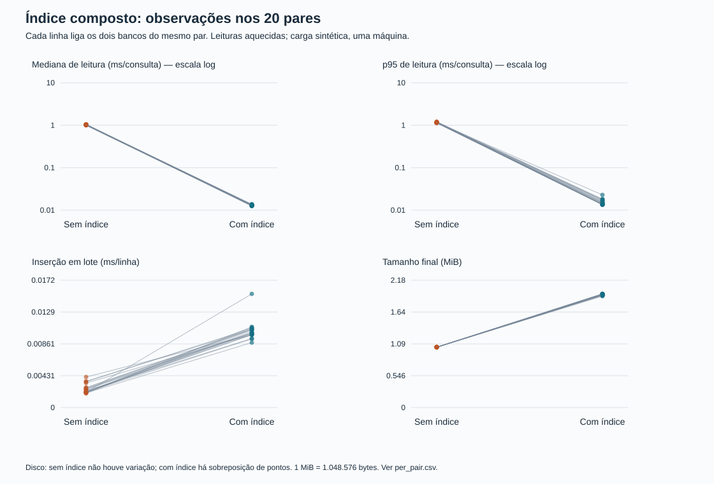
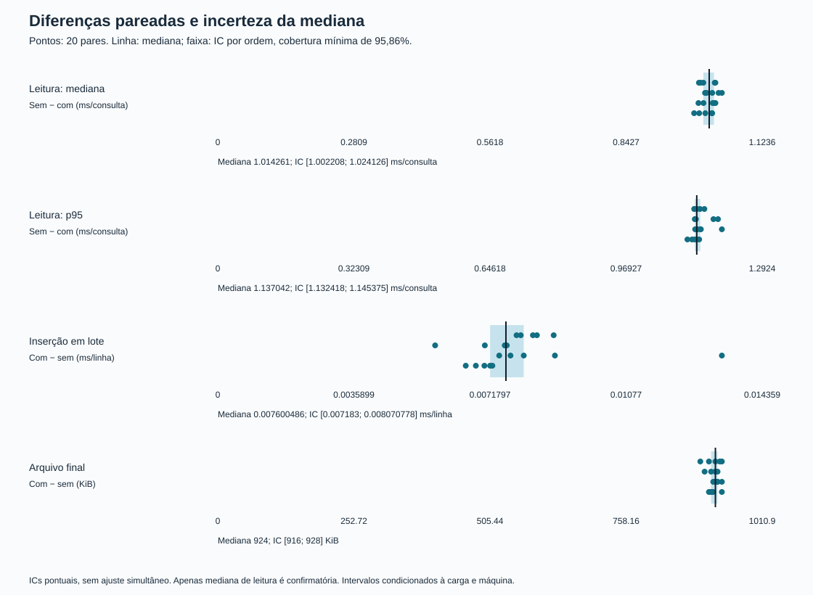

# Lab05S02 — efeitos do índice composto e validade

**Responsável pela análise:** Luidi · **Data:** 25/11/2026 · **Issue:** [#40](https://github.com/flavioferreiradev/Software-Measurement-and-Experimentation/issues/40).
Fonte exclusiva: coleta completa do Flávio no commit `dd31f1e`, em
[`results/full_s02/`](../results/full_s02/). O [protocolo congelado](protocolo_s02.md)
e a [execução/validação](coleta_s02.md) precedem esta análise. A coleta não foi
refeita; nenhum par ou tempo individual foi excluído. O piloto não entra nos testes.

## Resposta à pergunta de pesquisa

**Nesta carga sintética e nesta máquina, o índice `(customer_id, created_at DESC)`
reduziu a latência de pedidos recentes por cliente em todos os 20 pares.** A
redução mediana pareada foi **1,014261 ms por consulta**, com intervalo de
confiança bilateral de **[1,002208; 1,0241255] ms**. A razão mediana
`sem índice / com índice` foi **78,1881**, equivalente à redução percentual
mediana de **98,7210%**. A evidência estatística favorece a hipótese principal
de melhora, sob as condições de independência e comparabilidade descritas abaixo.

O benefício tem custos: o tempo por linha inserida em lote ficou **4,3015 vezes**
o da condição sem índice (aumento mediano de **330,1533%**) e o arquivo final
ficou **1,8717 vez** maior (aumento de **87,1698%**). Estes resultados não
medem desempenho ou impacto econômico de uma aplicação em produção. A decisão
em um sistema real depende da consulta, do volume, da concorrência, do cache,
da configuração e da proporção de leituras e escritas desse sistema.

## Dados, unidade de análise e estimandos

O ambiente **da coleta**, conforme `metadata.json`, foi Python 3.15.2,
SQLite 3.53.4, macOS 26.7.3 arm64. Foram usados `journal_mode=DELETE`,
`synchronous=FULL` e cache de 2.000 KiB. O modelo exato de CPU, a memória
física e o dispositivo de armazenamento não estão registrados; isso limita
a caracterização e a reprodução do hardware.

Cada par contém dois bancos novos com a mesma semente e os mesmos dados:
50.000 pedidos iniciais, 2.500 clientes e 51.500 pedidos finais. Em cada
condição há 150 leituras cronometradas (50 clientes em três blocos) e três
lotes de 500 inserções. São **20 pares independentes pelo desenho**,
**6.000 leituras** e **120 lotes** no total. As leituras e os lotes são
submedições: em cada comparação inferencial e intervalo, **n = 20**.

Para cada par r, a análise calcula:

| Métrica por condição | Agregação dentro do par | Efeito e direção positiva |
|---|---|---|
| Leitura primária | Mediana das 150 durações em ms | Dᵣ = mediana sem − mediana com; razão = sem/com |
| Cauda de leitura, secundária | p95 das 150 durações em ms | p95 sem − p95 com; razão = sem/com |
| Custo de inserção, secundário | Soma dos três tempos / 1.500 linhas, em ms/linha | Custo com − custo sem; razão = com/sem |
| Armazenamento, secundário | Bytes finais de cada banco nos metadados | Bytes com − bytes sem; razão = com/sem |

Uma diferença entre medianas dentro do par é o estimando congelado, e não
a mediana das 150 diferenças consulta a consulta. A estimativa final é a
mediana dos **20 efeitos pareados**; a razão final é a mediana das **20 razões**.
Ela não é calculada dividindo as medianas marginais. Para qualquer métrica,
a mudança percentual por par é `100 × (com/sem − 1)`.

O custo por linha representa a amortização do lote, incluindo `executemany`
e `commit`; não é o tempo de uma inserção individual com commit próprio.
O custo de construir inicialmente o índice é separado: mediana **12,650417 ms**,
não incluída na consulta nem na manutenção durante as inserções.

## Estatísticas descritivas

Na tabela, cada entrada resume 20 valores por condição. Na linha p95, o valor
é a mediana dos **20 p95 de cada banco**, e não o p95 global das 3.000 leituras.
DP é o desvio padrão amostral entre pares; IQR é Q75 − Q25 entre pares.

| Métrica | Mediana sem | Mediana com | DP sem / com | IQR sem / com |
|---|---:|---:|---:|---:|
| Mediana de leitura (ms/consulta) | 1,02743775 | 0,013021 | 0,01592066 / 0,00035027 | 0,027875 / 0,0004585 |
| p95 de leitura (ms/consulta) | 1,1523965 | 0,0145415 | 0,02138893 / 0,00237178 | 0,014791 / 0,002958 |
| Inserção em lote (ms/linha) | 0,002270445 | 0,010105555 | 0,000626394 / 0,001297206 | 0,000598389 / 0,000730805 |
| Arquivo final (bytes) | 1.085.440 | 2.031.616 | 0 / 10.828,846 | 0 / 12.288 |

As [tabelas geradas](../results/analysis_s02/tables.md) incluem média, mediana,
p95, DP, IQR, mínimo e máximo entre pares, além dos efeitos dos 20 pares.
O [CSV por par](../results/analysis_s02/per_pair.csv) também contém mediana,
p95 e dispersão **dentro de cada banco**, com 150 consultas ou três lotes.
O p95 de três lotes é apenas o máximo e tem pouco valor como estimativa de cauda.
Todos os percentis usam *nearest-rank*, `x[ceil(p × n)]`, com posições a partir
de 1. A mediana usa a média dos dois centrais quando n é par.

Os resumos agrupados da coleta continuam corretos: medianas globais de
1,025625 e 0,012958 ms por consulta; p95 globais de 1,155167 e 0,015750 ms;
medianas de custo dos 60 lotes de 0,002374458 e 0,009935125 ms/linha.
Esses diagnósticos de submedições diferem dos estimandos acima e não fornecem
6.000 réplicas para o teste. O script revalida o `summary.json` original
contra os arquivos brutos antes da análise.



As escalas de leitura são logarítmicas para mostrar as duas condições.
Escrita e disco usam escalas lineares iniciadas em zero. Cada segmento liga
os dois bancos do mesmo par. Há pontos sobrepostos, especialmente em disco;
o arquivo sem índice tem o mesmo tamanho nos 20 pares, mas o indexado varia.

## Diferenças, razões e tamanho do efeito

Os intervalos abaixo são para a **mediana populacional condicional dos efeitos
por par**, sob o modelo de repetição desta carga neste ambiente. São
bilaterais, pontuais, com nível nominal de 95% e cobertura mínima efetiva de
**95,861053%** devido à discretização binomial. Não são intervalos de previsão
para uma próxima consulta, nem intervalos simultâneos para todas as métricas.

| Efeito | Mediana da diferença | IC da mediana da diferença | Mediana da razão | IC da mediana da razão |
|---|---:|---|---:|---|
| Redução da mediana de leitura | 1,014261 ms | [1,002208; 1,0241255] ms | 78,188096 | [77,288689; 79,409530] |
| Redução do p95 de leitura | 1,137042 ms | [1,132418; 1,145375] ms | 78,764146 | [72,607007; 84,422018] |
| Acréscimo de inserção | 0,007600486 ms/linha | [0,007183; 0,008070778] ms/linha | 4,301533 | [3,942909; 4,807968] |
| Acréscimo do arquivo | 946.176 bytes | [937.984; 950.272] bytes | 1,871698 | [1,864151; 1,875472] |

Os tamanhos de efeito principais são expressos nas unidades de interesse
(ms, ms/linha e bytes) e em razões adimensionais. O custo de inserção adicional
mediano é **7,600486 µs/linha**; o acréscimo mediano de disco é **924 KiB**
(`1 KiB = 1.024 bytes`). As diferenças de leitura, inserção e disco foram
positivas em todos os pares. A dominância de sinais pareados da leitura,
`(n positivos − n negativos) / 20`, é **1**, em uma escala de −1 a 1.
Ela descreve a consistência observada da direção, não a magnitude nem uma
garantia de que todo par futuro terá melhora.



## Hipótese principal e inferência

Mantivemos a direção da [proposta S01](proposta_s01.md):
**H₀: mediana(Dᵣ) ≤ 0; H₁: mediana(Dᵣ) > 0**, com α = 0,05.
O procedimento escolhido nesta análise, não especificado em detalhe antes
da coleta, é o **teste exato dos sinais pareado unilateral**. Ele corresponde
à hipótese sobre a mediana, sem exigir normalidade das latências ou simetria
das diferenças. O teste t pareado teria como alvo a média; uma interpretação
de Wilcoxon como teste de localização exigiria condições adicionais de simetria.
Não selecionamos o teste por um pré-teste de normalidade.

Pressupomos pares independentes e comparáveis entre repetições, com distribuição
estável o suficiente para representar repetições do mesmo experimento. Na
fronteira contínua de H₀, `P(Dᵣ > 0) = 0,5`; no restante de H₀ esse valor
é no máximo 0,5. Logo `K = número de diferenças positivas` é comparado à
cauda superior de `Binomial(20; 0,5)`. A implementação mantém diferenças
exatamente zero como não positivas, de modo conservador para essa hipótese;
**não houve zeros nesta coleta**. Medições dentro dos pares podem ser
dependentes; isso não cria graus de liberdade adicionais.

Observamos **K = 20**, com zero negativos e zero empates. O p-valor é
`P(K ≥ 20 | n=20, p=0,5) = 2⁻²⁰ = 0,0000009536743164`.
**Rejeitamos H₀ a 5%**: há evidência de redução da mediana de leitura neste
desenho. Sob H₀ e os pressupostos, esse é o limite da probabilidade de obter
tantos sinais positivos quanto observados; não é a probabilidade de H₀ ser
verdadeira. O teste usa a direção, enquanto as diferenças e razões quantificam
a relevância prática local. A descrição do teste binomial pareado pode ser
consultada no [NIST](https://www.itl.nist.gov/div898/software/dataplot/refman1/auxillar/signtest.htm).

O IC bilateral vem da inversão do teste dos sinais: ordenamos os 20 efeitos
e usamos **[D(6); D(15)]**. Sua cobertura mínima é
`1 − 2 × P(Binomial(20; 0,5) ≤ 5) = 0,9586105347`. O mesmo método foi
aplicado às diferenças e razões secundárias. Com empates, inclusive os
bytes discretos, ele pode ser mais conservador. A construção por estatísticas
de ordem está exemplificada nas [notas de Charles Geyer, Universidade de Minnesota](https://www.stat.umn.edu/geyer/5102/examp/sign.html).
O intervalo de leitura permanece inteiramente positivo. Sua cobertura é uma
propriedade de repetições sob o modelo, não uma probabilidade atribuída ao
parâmetro fixo após observar os dados.

Somente a mediana de leitura recebe decisão confirmatória. p95, escrita e
disco são efeitos secundários com intervalos pontuais, sem testes adicionais
ou afirmação de controle simultâneo do erro familiar.

## Ameaças à validade revisadas

| Tipo | Evidência e mitigação nesta S02 | Limitação residual e consequência |
|---|---|---|
| **Conclusão** | Agregação em 20 pares; teste de mediana exato, efeito e IC; nenhuma remoção de extremos; conferência independente das agregações e dos hashes. | Vinte pares dão resolução e precisão limitadas. O teste dos sinais ignora magnitude. O procedimento foi escolhido após a coleta, embora a hipótese e o estimando fossem prévios. Pares foram executados na mesma sessão: deriva térmica, cache e carga do SO podem correlacioná-los, violando independência e tornando p/IC otimistas. ICs secundários são pontuais. Não se infere precisão de produção a partir destes intervalos. |
| **Interna** | Dados, clientes, consultas, esquema e PRAGMAs iguais dentro do par; bancos novos; aquecimento; alternância de ordem de leitura e escrita inversa; planos esperados e resultados iguais verificados pelo executor; sem outra carga intencional segundo o registro. | Alternância é determinística e não uma randomização completa. SO, frequência da CPU, cache de arquivos e efeitos de ordem podem persistir. Não há telemetria do sistema para excluí-los. Bancos temporários foram removidos: igualdade de conteúdo é evidência registrada pelo executor, não algo que possamos reexecutar nos bancos originais agora. |
| **Construto** | Consulta inclui materialização em Python; escrita inclui commit; bytes finais e construção do índice são separados. Planos mudam de scan/ordenação para busca pelo índice. Custos de escrita e disco evitam avaliar somente leitura. | Uma consulta aquecida com LIMIT 20 e clientes uniformes não representa latência de aplicação completa. O p95 é de amostras pequenas e repetidas; não mede SLA sob carga. Ms/linha de lote não representa inserções individuais. Bytes do arquivo não incluem picos de journal, RAM, backups ou energia. O tempo de construir o índice não mede migração em produção. |
| **Externa** | Ambiente e protocolo explícitos, sementes variadas e arquivos versionados; resultados separados de cenários de aplicação. | Uma máquina, uma sessão, um SQLite e uma distribuição sintética; hardware incompletamente descrito. Sem WAL, concorrência, rede, grandes volumes, clientes concentrados, atualizações ou deleções. Sementes distintas não amostram dispositivos e empresas. Os ganhos locais não demonstram ganhos em outras aplicações, impacto financeiro nem a meta de impacto real. |

Para aplicações reais, estes achados justificam **avaliar** o índice para
consultas semelhantes e medir o custo na carga efetiva. Não justificam
prometer uma redução de 98,7% na latência total de um produto. Eventuais contas
de impacto da S03 devem rotular volumes e proporções como cenários quando
não forem medidos e considerar os custos de manutenção e implantação.

## Reprodução e trilha de auditoria

Na raiz do repositório, use **Python 3.10+**, sem pacotes externos. A análise
não executa SQL nem requer que o SQLite instalado seja 3.53.4; essa versão é
exigida nos metadados **da coleta**. A análise foi verificada aqui com Python
3.13.3 no Windows. Não execute o coletor para reproduzir estes resultados.

```bash
python Laboratorio5/src/analyze_s02.py
python -m unittest discover -s Laboratorio5/tests -p test_analysis_s02.py -v
```

Para comparar sem substituir os resultados derivados versionados:

```bash
python Laboratorio5/src/analyze_s02.py --input-dir Laboratorio5/results/full_s02 --output-dir .pytest-tmp/lab05-analysis-check
git diff --no-index -- Laboratorio5/results/analysis_s02 .pytest-tmp/lab05-analysis-check
```

O segundo comando deve retornar código 0 no mesmo checkout. Em checkouts com
fins de linha diferentes, `audit.json` registra hashes físicos diferentes;
os hashes canônicos da origem e os resultados numéricos permanecem iguais.
Um checkout Git com CRLF pode divergir dos SHA-256 LF publicados: somente
nessa situação o script tenta CRLF→LF **em cópia temporária**, exigindo que
o hash resultante coincida exatamente com `validation.json`. Nenhum outro
ajuste é aceito. A descoberta e o tratamento são registrados nesta seção;
não houve defeito nos valores nem alteração dos dados da coleta.

O script executa `validate_full_s02.validate` nessa cópia e exige o mesmo
relatório de validação original: 20 pares, 6.000 leituras, 120 lotes,
sementes, planos, pareamento, contagens, durações, hashes e resumo bruto.
Os testes usam cálculo independente com `Decimal` diretamente dos CSVs e
metadados para conferir os quatro desfechos e seus efeitos em **todos os 20
pares**. Também verificam a cauda binomial, os índices do IC, empates,
ponderação de inserções, detecção de corrupção, preservação da origem e
repetibilidade byte a byte dos sete artefatos na mesma execução Python.
Nenhum desses testes executa coleta.

| Artefato em `results/analysis_s02/` | Como auditar |
|---|---|
| [`audit.json`](../results/analysis_s02/audit.json) | Commit da coleta, hashes físicos/canônicos, normalização e resultado da revalidação |
| [`per_pair.csv`](../results/analysis_s02/per_pair.csv) | Filtrar `replication` e `condition` nos CSVs brutos; conferir as agregações e os efeitos do par |
| [`descriptive.csv`](../results/analysis_s02/descriptive.csv) | Reagrupar as 20 linhas do CSV por par; inclui dispersão dos efeitos e ICs das medianas |
| [`summary.json`](../results/analysis_s02/summary.json) | Métodos, convenções, teste principal, sinais, p-valor, efeitos e ICs sem arredondamento de apresentação |
| [`tables.md`](../results/analysis_s02/tables.md) | Tabelas arredondadas geradas diretamente do mesmo resumo e dos pares |
| [`paired_metrics.svg`](../results/analysis_s02/paired_metrics.svg) e [`paired_effects.svg`](../results/analysis_s02/paired_effects.svg) | Figuras vetoriais; os pontos têm títulos com par e valor, e são desenhados dos mesmos dados |

Exemplo para rastrear a estimativa: filtre as 150 durações do par 1 em cada
condição; converta ns para ms e tire as medianas. Sua diferença é
**1,025604 ms** e a razão é **77,9222231**. Repita para os demais pares,
ordene as 20 diferenças e obtenha a mediana **1,014261 ms** e os limites
nas posições 6 e 15. Para escrita, some os três `duration_ns` e divida por
`1.500 × 1.000.000`; `ns_per_row` também é conferido pelo validador, mas o
agregador calcula o custo diretamente de duração e quantidade. Para disco,
use `replications[r].database_bytes` de `metadata.json`.
